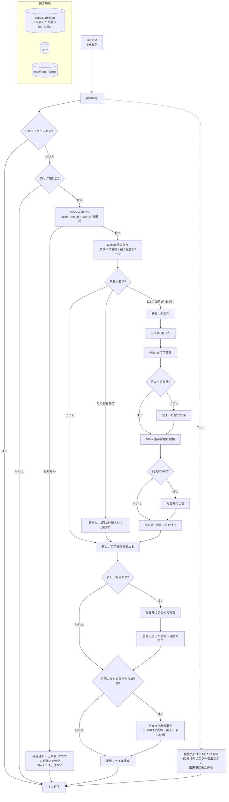

Here is the result of "fetch" for the Page with URL https://app.notion.com/p/414f1dff94dc81f78662e5a652096b73 as of 2026-11-10T14:32:02.237Z:
<page url="https://app.notion.com/p/414f1dff94dc81f78662e5a652096b73">
<ancestor-path></ancestor-path>
<properties>
{"title":"要件定義書\\_りり見回りプログラム"}
</properties>
<iconMetadata>null</iconMetadata>
<content>
# 要件定義書｜りり見回りプログラム

- 作成：うさ（2026-11-10）
- 実装：みに（Codex）
- 確認：たかむね
- 段階：たたき台 第2.2版（たかむね承認の2点を反映：ログは自動で消さない／投稿結果が不明なら再投稿せず保留）
- 読んだNotionページ（2026-11-10 16:00ごろ JST時点）：りりへの依頼／りりのログ／りり連携テンプレート／りりの運用ガイド／りり❤️とみんなのやり取り📖／完了報告5ページ（あいす・のあ・みに・かれん・うさ）
- 「<b>要確認</b>」と書いたところは、たかむねに決めてもらうか、実物で確かめる必要があるところです。

## 変更履歴

| 版 | 日時（JST） | 内容 |
| --- | --- | --- |
| 第2.2版 | 2026-11-10 23:30 | たかむねの決定を反映：①ログ（状態ファイル、<code>logs/*.jsonl</code>、練習ログ、<code>patrol.log</code> など）は<b>自動では消さない</b>（7日／30日の削除はやめる）。大きくなったときは<b>週1回まで</b>、「たかむねりりあいす」への報告で掃除するか聞く。削除するローテーションは付けない ②Slack投稿の結果が不明（タイムアウト・途中停止）で、履歴確認でも出たか分からないときは<b>再投稿しない</b>。状態ファイルで<b>保留</b>（<code>held</code>）にし、その依頼の処理を止める。いつものエラー連絡（60分に1回まで）でたかむねに手動確認を頼む。再開は、たかむねが状態ファイルを直すか、<code>python3 patrol.py --resolve <依頼ID> posted または not_posted</code> を実行したあと |
| 第2.1版 | 2026-11-10 19:30 | 調べて分かったことを反映：konokariri（U0CFH9JRCKV）は<b>もうあるSlackアプリのボットユーザー</b>（bot\_id は B0CFRD8ETQR の見こみ）で、#りりの指示部屋 と「たかむねりりあいす」の<b>両方にもう入っている</b> → 報告先の代わりは不要。Notion API は最新版 <code>2026-03-11</code> を使い、行の差しこみは <code>position: after_block</code>（<code>after</code> は古い書き方）。Notionの速さ制限（1分180回）と429/529の扱いを反映。セットアップ手順書を別ファイルで作成 |
| 第2版 | 2026-11-10 18:15 | たかむねの決定を反映：①何もなかった回はログを書かない。ログはMacにためて<b>3時間に1回まとめてNotionへ</b>（30分ルールは削除）。前回の見回り時刻は状態ファイルから ②りり自身あての依頼は「たかむねりりあいす」に1回知らせて飛ばす（確定） ③Slackは<b>アプリのボットトークン（xoxb）</b>。見え方をkonokaririにする設定、必要な権限、起動時のアカウント確認を作り直し ④宛先全員の完了報告で自動的に完了（確定） ⑤<b>練習モード</b>（最初はこれが既定。本番はたかむねのOK後）、1回の指示投稿は最大1件、\*\*止めるスイッチ（STOPファイル）\*\*を追加 ⑥依頼に「宛先」欄を追加（直るまでは@名前で代用）、テストは新しいID、古いりりのスケジュール停止と「りりへの依頼」ページの復旧（かれん）を本番前の前提に |
| 第1版 | 2026-11-10 17:50 | たたき台 |

---

## 1. 目的

りりの「5分おきの見回り」を、<b>Macの決まったプログラムが確実に回す</b>ようにする。

- 時間どおりに動くこと、同じ投稿をくり返さないこと、konokaririから投稿すること、ログを表に書くこと、依頼の状態を更新すること。これらを<b>コードで保証</b>する。
- りりのAI（ローカルLLM）は、<b>依頼1件ぶんのSlack文面の下書き</b>だけに使う。AIが失敗しても、決まった型の文面で必ず回るようにする。

ゴール：りりは「決まった流れで依頼を配って、完了報告を集める係」として、人の手直しなしで毎日回る。

---

## 2. 背景・課題

### 2.1 背景

- りりは Mac mini M6（メモリ32GB）で動くローカルLLMのエージェント。
- モデルは Ollama の <code>qwen3.6:35b-a3b</code>（<code>num_ctx 32768</code>）に変える予定（今は Qwen3.5 9B）。
- ヒロインズの連絡はりりを通す決まり（りり連携テンプレート）。依頼は Notion「りりへの依頼」、指示は Slack #りりの指示部屋、完了報告は人別の完了報告ページ、りりの報告は Slack グループDM「たかむねりりあいす」。

### 2.2 今までに起きた問題（2026-11-09〜11-10のテスト）

| # | 起きたこと | 原因（見立て） |
| --- | --- | --- |
| P1 | 同じ指示を何度も投稿した（💛20261110-1 を 4:05／4:47／5:20／6:03、💛20261110-2 を 2:07／9:20／10:20、ほか16:20ごろにも投稿） | 前回なにをしたか覚えていない。状態を更新しない |
| P2 | 依頼IDを使い回した（同じIDで別の回のテスト） | IDの管理をAIの記憶に頼っていた |
| P3 | 「りりへの依頼」の状態欄を更新しなかった | 手順が長く、AIが抜かす |
| P4 | ログを表の外に文章で書いた（りりのログ、りりへの依頼、親ページにまで書いた） | 書く場所をAIが判断していた |
| P5 | たかむねのSlackアカウント（U0C5V11S37X）から投稿した | Slackのログインがたかむねのまま。投稿前の確認が効いていない |
| P6 | 5分おきに動かない／時刻がずれる | りり自身にスケジューラーがない |
| P7 | テンプレの項目（期限・報告先・GitHub）が抜けた指示を出した | 文面をAIが毎回ゼロから作っていた |

### 2.3 課題（このプログラムで解くこと）

1. 時間どおりに動く仕組み（launchd）。
2. 「何をもう処理したか」をAIではなくファイルで覚える。
3. Slackの投稿元を、りり用アプリのボットトークンと起動時の確認で固定する（たかむねのアカウントからは出ない）。
4. 決まった手順（状態更新・ログ・報告）を全部コードで行う。
5. 文面の必須項目をコードで確かめる。

---

## 3. 範囲

### 3.1 やること

- 5分おきの見回り（launchdで起動）。
- 止めるスイッチ（STOPファイル）の確認。
- Slackアカウントの確認（auth.test。ボットトークンであることと、決められたボットであること）。
- 「りりへの依頼」から<b>未着手</b>の依頼を探し、来た順に1件ずつ、状態更新→ログ→Slack指示投稿→ログ。
- みに宛ての依頼があれば「たかむねりりあいす」に伝言。
- りり自身あての依頼は「たかむねりりあいす」に1回だけ知らせて飛ばす。
- 完了報告5ページから、前回から増えた報告だけ拾って「たかむねりりあいす」に短く報告。
- 宛先全員の完了報告がそろった依頼を<b>自動で完了</b>にする。
- 出来事（拾った・投稿した・報告を見つけた・エラー・アカウント違い）をMacにためて、<b>3時間に1回まとめて</b>「りりのログ」の表の一番上に書く。
- エラー時は「たかむねりりあいす」にすぐ1回だけ短く知らせて、その回を止める。
- <b>練習モード</b>（何も投稿・書きこみせず、「出すはずだったもの」を記録するだけ）。最初はこれで動かす。

### 3.2 やらないこと

- 依頼の中身の作業（調べもの、コードを書く、PC操作など）。りり自身あての依頼もここに入る。
- 書き方が崩れた依頼・報告をうまく読み解くこと（読めなければ止めて返す）。
- ファイル削除、アプリのインストール、買い物。Notionのブロック削除、Slackメッセージの削除・編集。
- 実在のSlackユーザーへの本物のメンション（<code><@U…></code>）。宛先は文字の「@名前」だけ。
- みにへの直接連絡（みにはSlackを読めない。あいすかたかむねが届ける）。
- たかむねのSlackアカウント（U0C5V11S37X）やユーザートークン（xoxp）での投稿。
- Macの電源が切れている・ネットにつながっていないときの動作。
- 既存ページの散らかったテキスト（表の外のログなど）の掃除。

---

## 4. 機能要件

要件には番号をつけます（FR-xx）。

### FR-00 止めるスイッチ

- 起動してすぐ、<code>~/riri-patrol/STOP</code> というファイルがあるか確かめる（場所は <code>.env</code> の <code>STOP_FILE</code> で変えられる）。
- あれば<b>何もせずすぐ終了</b>する（Slack・Notion・LLMに一切さわらない。状態ファイルも変えない）。ファイルログに「STOPのため終了」を1行だけ残す。
- 止め方：<code>touch ~/riri-patrol/STOP</code>。再開：<code>rm ~/riri-patrol/STOP</code>（どちらもたかむねが行う。プログラムはこのファイルを作ったり消したりしない）。

### FR-01 定期起動

- launchd で <b>5分（300秒）おき</b>に1回起動する。Mac起動時にも1回動く。
- 1回の実行は<b>最大4分</b>で打ち切る（次の回と重ならないため）。

### FR-02 二重起動の防止

- ロックファイルを取れなかったら、何もせず終了する（ファイルログに「ロック中のためスキップ」とだけ残す）。

### FR-03 アカウント確認（ボットトークン）

- 最初に Slack <code>auth.test</code> を呼ぶ。次の<b>全部</b>を満たさないと「アカウント違いで停止」：
  1. <code>.env</code> の <code>SLACK_BOT_TOKEN</code> が <code>xoxb-</code> で始まる（<code>xoxp-</code>＝人のトークン、そのほかは不可）。
  2. <code>auth.test</code> の結果に <code>bot_id</code> がある（ボットのトークンである）。
  3. <code>bot_id</code> が <code>.env</code> の <code>EXPECTED_SLACK_BOT_ID</code> と同じ。
  4. <code>user_id</code>（ボットユーザーのID）が <code>.env</code> の <code>EXPECTED_SLACK_USER_ID</code> と同じ。
  5. <code>user_id</code> が <code>U0C5V11S37X</code>（たかむね）では<b>ない</b>（コードに直書きした禁止リスト。<code>.env</code> で変えられない）。
- 「アカウント違いで停止」のとき：
  - Slackには<b>何も投稿しない</b>（そのトークンで投稿すると、まちがったアカウントから出てしまうため）。
  - かわりに、Macの画面通知（<code>osascript -e 'display notification …'</code>）とファイルログで知らせる。
  - ログの出来事「アカウント違いで停止」をためる（同じ状態が続く間は60分に1件まで）。
  - その回はそこで終了。
- 投稿する関数（<code>slack.post</code>）の中でも、毎回「この回のアカウント確認に合格しているか」を確かめ、合格していなければ投稿しない（二重の安全装置）。

### FR-04 前回の見回り時刻

- 前回の見回り時刻は<b>Macの状態ファイルの値</b>（<code>last_run_at</code>）を使う。Notionのログは読まない。
- 状態ファイルがない（初回）ときは「初回」として扱う（FR-09の初回ルール）。

### FR-05 未着手の依頼を処理する

1. 「りりへの依頼」から【りりへの依頼】ブロックを全部読み、<code>状態：未着手</code> のものを集める。
2. <b>来た順</b>に並べる（ページは新しいものが上なので、ページの下から上の順。詳しくは付録A-2）。
3. 状態ファイルで「投稿済み」「飛ばし済み」「保留」になっている依頼IDは飛ばす。
4. <b>1回の実行で出す指示投稿は最大1件</b>（<code>MAX_INSTRUCTION_POSTS_PER_RUN=1</code>、コードで上限をかける）。残りは次の回にまわす。
5. その1件について、この順で行う：
   1. 必須項目を確かめる（FR-06）。足りなければ FR-11 の「依頼の不足」として止める。
   2. 宛先がりり自身だけなら FR-14 へ。
   3. 依頼ページの状態を <code>対応中</code> に書きかえる。
   4. 出来事「拾った」をためる。
   5. Slack #りりの指示部屋 に指示を投稿する（FR-07）。
   6. 宛先にみにがいれば、「たかむねりりあいす」に伝言を投稿する（FR-08）。
   7. 出来事「投稿した」（投稿時刻・Slackのts付き）をためる。

### FR-06 依頼の必須項目と「宛先」欄

- 次がそろっていなければ処理しない：依頼ID、依頼した子、宛先、やること（一文で）、期限・実行タイミング。
- <b>依頼の形に「宛先」欄を足す</b>（決定）：<br /><code>宛先（あいす／のあ／かれん／みに／うさ／りり）：@あいす @かれん</code>
  - テンプレ1（りり連携テンプレート）と「りりへの依頼」のひな型に、この欄を足してもらう（Notionの書きかえは、たかむねのOK後に別でやる）。
  - <b>テンプレが直るまでの代わり</b>：欄がない依頼は、「やること」「手順」の中の <code>@あいす @のあ @かれん @うさ @みに</code> を拾う。1人も見つからなければ止める。
  - 欄があるときは欄だけを使い、本文の@名前は見ない。
- 依頼IDは <code>^(🤍|💚|💙|🩵|❤️|💛)\d{8}-\d+$</code> の形であること。

### FR-07 指示の投稿（#りりの指示部屋）

- 投稿先：<code>C0CFM2HRA5V</code>。
- 必ず入れる項目（運用ガイド 2026-11-10 たかむね承認の最低限）：
  - 依頼ID
  - 宛先の@名前（文頭に文字で）
  - 何を
  - いつまでに
  - 報告先（宛先それぞれの完了報告ページ ＋ 「たかむねりりあいす」）
  - GitHubプロジェクト（なければ「なし」）
- 文面はLLMに下書きさせ、コードで確かめ、だめなら決まった型の文面にする（付録A-5）。
- 投稿の結果が分からないとき（タイムアウト・途中停止など）は、<b>自動では再投稿しない</b>（NFR-06）。

### FR-08 みに宛ての伝言

- 宛先にみにが入っていたら、「たかむねりりあいす」（<code>SLACK_REPORT_CHANNEL</code>＝<code>C0CFL6A8QJH</code>。konokariri はもう入っている。6.1）にこれを投稿する：<br /><code>みにへの依頼があるので、あいすかたかむねから伝えてください（依頼ID：{ID}）🍚</code>
- 文面は固定（LLMは使わない）。

### FR-09 新しい完了報告を拾って報告する

- 完了報告5ページの【完了報告】ブロックを読む。
- <b>ブロックID＋本文のハッシュ</b>で「見たことがあるか」を判断し、新しいものだけ拾う（同じ依頼IDが何度も使われているため、依頼IDだけでは判断しない）。
- <b>初回（状態ファイルがないとき）は、今ある報告を全部「見た」として登録だけし、報告はしない</b>（昔の報告をまとめて流さないため）。
- 新しい報告があれば、その回で<b>1通にまとめて</b>「たかむねりりあいす」に投稿する。1件1行：<br /><code>・{報告した子}：{依頼ID} → {結果}（{やったことの先頭40文字}）</code>
- 拾った報告ごとに出来事「完了報告を見つけた」をためる。
- 文面は固定の型（LLMは使わない）。

### FR-10 完了にする（確定）

- 依頼ごとに、宛先全員の完了報告（その依頼IDで、<code>結果：完了</code>）がそろったら、<b>自動で</b>依頼ページの状態を <code>完了</code> にする。たかむねの確認は待たない。
- <code>一部完了</code>／<code>できなかった</code> はそろった数に入れない。報告にはそのまま載せる。
- 完了にしたら出来事「完了にした」をためる。

### FR-11 エラー時

- その回の処理を止める。
- 「たかむねりりあいす」に<b>すぐ</b>短く1通：<code>りりの見回りでエラーが出たので止めました🍚 {種類}：{一言}（{時刻} JST）</code>
- 同じ種類のエラーは<b>60分に1回まで</b>しか投稿しない（状態ファイルで管理）。
- 次の回が正常に終わったら、<code>直りました🍚🔥</code> を1回だけ投稿する。
- エラーの出来事もためて、3時間ごとのまとめ書きでNotionに書く（Notionへの書きこみだけがまとめ。Slackの連絡はすぐ）。
- アカウント違い（FR-03）のときは Slack に投稿しない（画面通知だけ）。

### FR-12 ログ（ためて、3時間に1回まとめて書く）

- <b>何もなかった回は、ログを作らない</b>（出来事が0件なら何もためない）。
- ためる出来事：依頼を拾った／Slackに投稿した（投稿時刻つき）／完了報告を見つけた／完了にした／りり自身あてで飛ばした／エラー／アカウント違いで停止。
- 出来事は、起きたときに状態ファイルの <code>log_buffer</code> に入れる（<b>起きた時刻をそのまま持つ</b>）。同じ内容をファイルログ <code>logs/events.jsonl</code> にも書く。
- <b>3時間に1回</b>（前回まとめて書いた時刻 <code>last_log_flush_at</code> から180分たった最初の回。<code>LOG_FLUSH_EVERY_MIN=180</code>）、たまった出来事を全部、「りりのログ」の表の<b>一番上</b>に、<b>新しいものが上</b>になる並びで書く。
- 書けたら、その出来事を <code>log_buffer</code> から消す。書けなかったら残して次の回にもう一度ためす（エラー連絡は60分に1回まで）。
- 手で今すぐ書きたいときは <code>python3 patrol.py --flush-log</code>。
- 表の外には何も書かない。

### FR-13 練習モード と dry-run

- 動き方（モード）は2つ：<code>練習</code>（practice）と <code>本番</code>（live）。<code>.env</code> の <code>RIRI_MODE</code> で決める。<b>既定は練習</b>（<code>RIRI_MODE</code> がない・まちがった値のときも練習）。
- <b>練習モード</b>：
  - Slackへの投稿、Notionへの書きこみ（状態の書きかえ・ログ）を<b>一切しない</b>。
  - 読み取り（Notion）、<code>auth.test</code>、LLMの下書きとチェックは本物を動かす。
  - 「出すはずだった投稿」「書くはずだった状態・ログ」を <code>logs/practice.jsonl</code> に1件ずつ記録する（いつ・どこへ・文面）。
  - 状態ファイルは練習用（<code>state/state.practice.json</code>）を使う。本番用は変えない。練習で「投稿したことにした」依頼は、本番に切りかえたあと、本番として1回出る。
- <b>本番への切りかえは、たかむねが練習の記録を見てOKを出してから</b>。たかむねが <code>.env</code> を <code>RIRI_MODE=live</code> に書きかえる（プログラムが自分で切りかえることはない）。
- 本番に切りかえた最初の回は、FR-09の初回ルール（昔の報告は流さない）が本番用の状態ファイルにも効く。
- <code>--dry-run</code>：その1回だけ練習モードで動かし、記録を画面にも出す（本番の設定のままでも書きこまない）。

### FR-14 りり自身あての依頼（確定）

- 宛先がりりだけの依頼（りりがMacで作業する依頼）は、このプログラムでは扱わない。
- 「たかむねりりあいす」に<b>1回だけ</b>知らせる：<code>{ID} はりり自身あての依頼なので、見回りプログラムでは扱えません。飛ばします🍚</code>
- 状態ファイルで「飛ばし済み」にして、二度と知らせない。依頼の状態は書きかえない（未着手のまま）。
- 宛先にりりとほかの子が両方いるときは、ほかの子へは通常どおり出し、りりの分だけこの知らせを出す。

---

## 5. 非機能要件

### 5.1 確実性

- NFR-01：1回の実行は最大4分。HTTPは1回20秒でタイムアウト、Notion/Slackは429のとき <code>Retry-After</code> に従って最大2回まで再試行。
- NFR-02：LLMが止まっていても見回りは回る（決まった型の文面で投稿する）。LLMの待ち時間は1回最大90秒。
- NFR-03：状態ファイルは「一時ファイルに書いて名前を変える」方法で書き、途中で落ちても壊れないようにする。
- NFR-04：止めるスイッチ（STOPファイル）は、ほかのどの処理よりも先に確かめる。

### 5.2 重複防止（同じ投稿を2回しない）

- NFR-05：Slackに投稿する<b>前</b>に、状態ファイルに「投稿しようとしている（posting）」と記録する。投稿できたら ts を記録して「posted」にする。
- NFR-06：「posting」のまま残っていたら（前の回が途中で落ちた、または投稿がタイムアウトした）、Slack <code>conversations.history</code> で直近24時間のこのボットの投稿に <code>依頼ID：{ID}</code> があるか確認する。
  - <b>投稿があると確認できた</b> → 「posted」にして再投稿しない。
  - <b>投稿がないと確認できた</b>（履歴の取得に成功し、見つからなかった） → その回で投稿してよい。
  - <b>出たか分からない</b>（履歴確認もタイムアウト・失敗・中断） → <b>再投稿しない</b>。状態ファイルでその依頼を<b>保留</b>（<code>held</code>）にし、以後その依頼は扱わない。いつものエラー連絡（FR-11、60分に1回まで）で「たかむねりりあいす」に、手で確認してほしいと知らせる。再開は、たかむねが状態ファイルを直すか、<code>python3 patrol.py --resolve <依頼ID> posted|not_posted</code> を実行したあとだけ。
- NFR-07：状態が <code>対応中</code> や <code>完了</code> の依頼には投稿しない。状態ファイルで posted／skipped／held（保留）の依頼IDにも投稿しない。ただし <code>--resolve not_posted</code> で保留を解除した依頼は、依頼ページが既に <code>対応中</code> でも、次の回で1回だけ投稿してよい。
- NFR-08：同じ依頼IDが依頼ページに2つ以上あったら（IDの使い回し）、<b>どちらも処理せず</b>、エラー「依頼IDが重なっています」として止める。
- NFR-09：1回の実行での投稿数に上限をかける：指示投稿は<b>1件</b>、全部あわせて<b>4件</b>（指示1・みに伝言1・報告まとめ1・エラー/直りました1）。上限をこえる投稿は次の回へ。
- NFR-10：ログのまとめ書きでも二重にならないようにする。出来事ごとに短いID（例 <code>#e7f3a1</code>）をつけてメモ列に入れ、書く前に表の上から50行を読んで、同じIDがある出来事は書かない。

### 5.3 セキュリティ

- NFR-11：トークンは Mac の <code>.env</code> だけに置く。git に入れない（<code>.gitignore</code> に <code>.env</code>、<code>state/</code>、<code>logs/</code>、<code>STOP</code>）。
- NFR-12：トークンの値をログ・Slack・Notion・画面に出さない（エラーメッセージからも <code>xox</code> や <code>ntn_</code>/<code>secret_</code> で始まる文字列を伏せ字にする）。
- NFR-13：LLMの下書きに <code>xox</code>、<code>ntn_</code>、<code>secret_</code>、<code>.env</code> の値が入っていたら不合格。
- NFR-14：Slackはボットトークン（xoxb）だけを使う。人のトークン（xoxp）は受けつけない。たかむね（U0C5V11S37X）としての投稿は、設定に関係なくコードで禁止。
- NFR-15：使うSlackの権限は投稿と読み取りだけ。削除や編集のAPIはコードに書かない。
- NFR-16：外部に新しい依存パッケージを入れない（Python標準ライブラリだけで作る。テストの pytest だけ例外、要確認）。

### 5.4 ログ

- NFR-17：Notionの「りりのログ」の表（9列）の<b>一番上の行</b>に、新しいものが上の並びで書く。書くのは3時間に1回のまとめ書きのときだけ。
- NFR-18：各行の「日時（JST）」は<b>出来事が起きた時刻</b>、「見回った時刻」は<b>その出来事が起きた回の開始時刻</b>（書いた時刻ではない）。
- NFR-19：Macの中にもファイルログ（<code>logs/patrol.log</code>＝動きの記録、<code>logs/events.jsonl</code>＝出来事、<code>logs/practice.jsonl</code>＝練習の記録）を残す。<b>状態ファイルもこれらのログも、プログラムは自動では消さない</b>（7日／30日など日数での削除や、削除するローテーションは付けない）。ファイルが大きくなったときは、<b>週に1回まで</b>、「たかむねりりあいす」への報告（3時間ごとのまとめ書きの回に含めてよい）で「ログが大きくなったので、掃除するか見てください🍚」とたかむねに聞く。掃除するかはたかむねが決める。
- NFR-20：何もなかった回は、Notionにもファイルの出来事ログにも書かない（<code>patrol.log</code> に「動いた・なにもなし」の1行だけ）。

---

## 6. 外部連携

| 相手 | 使うもの | 使い方 |
| --- | --- | --- |
| Slack | りり用Slackアプリのボットトークン（xoxb） | <code>auth.test</code>、<code>chat.postMessage</code>、<code>conversations.history</code>（重複確認だけ） |
| Notion | 連携（インテグレーション）トークン | ページのブロック読み取り、コードブロックの書きかえ、表への行の追加 |
| Ollama | <code>http://127.0.0.1:11434</code> | <code>/api/chat</code> でSlack文面の下書き |

### 6.1 Slack（ボットトークンでkonokaririとして見せる）

<b>決まったこと</b>：りりはSlackアプリのボットトークン（<code>xoxb-</code>）で投稿する。

<b>調べて分かったこと（2026-11-10 19:10 JST、Slackを読んで確認）</b>

- konokariri（<code>U0CFH9JRCKV</code>）は <b>Bot: Yes</b>＝人のアカウントではなく、<b>もうあるSlackアプリのボットユーザー</b>。いまりりのMacで動いている Hermes がこのボットとして投稿している（2026-11-09 19:56 の #りりの指示部屋 の投稿は konokariri 名義で出ていた）。
- そのボットの bot\_id は <b><code>B0CFRD8ETQR</code></b> の見こみ（Slackが見せるボットのメールアドレス <code>botuser-…-B0CFRD8ETQR@slack-bots.com</code> から読んだ値。<b>auth.test で最終確認</b>）。
- konokariri は #りりの指示部屋（<code>C0CFM2HRA5V</code>、2026-11-09 19:25ごろ参加）と、グループDM「たかむねりりあいす」（<code>C0CFL6A8QJH</code>、スレッドで返信している）の<b>両方にもう入っている</b>。
- 今までのまちがい（たかむね名義の投稿）は、りりが\*\*Composio の Slack 連携（たかむねのユーザー権限）\*\*を使って投稿したときに起きていた。konokariri のボットトークンで投稿すれば、konokariri として出る。
- 同じチャンネルに <code>riri-hermes</code>（<code>U0CF73EFLP5</code>）という別のボットもいる。まちがえないよう、<code>EXPECTED_SLACK_USER_ID</code> と <code>EXPECTED_SLACK_BOT_ID</code> の両方で確かめる。

<b>決めたこと</b>

- <b>新しいSlackアプリは作らない</b>。もうある konokariri のアプリ（ボット）のトークン（<code>xoxb-</code>）を使う。
- 表示名はもう <code>konokariri</code>。アイコンをりりにしたいときは、アプリ設定の「Basic Information」→「Display Information」→「App icon」で変える（512×512〜2000×2000 の正方形）。
- <code>chat:write.customize</code>（投稿ごとに名前・アイコンを変える権限）は<b>使わない</b>（もう konokariri として出るので不要）。<code>.env</code> の <code>SLACK_POST_USERNAME</code>／<code>SLACK_POST_ICON_URL</code> は空のままにする。
- <code>EXPECTED_SLACK_USER_ID=U0CFH9JRCKV</code>、<code>EXPECTED_SLACK_BOT_ID=B0CFRD8ETQR</code>（auth.test の結果で最終確認してから入れる）。

<b>必要な権限（Bot Token Scopes）</b>

- <code>chat:write</code>（投稿）
- <code>channels:history</code>（公開チャンネルの読み取り。重複確認用）
- <code>groups:history</code>（非公開チャンネルの読み取り。#りりの指示部屋 が非公開の場合）
- <code>mpim:history</code>（グループDMの読み取り。<code>C0CFL6A8QJH</code> はグループDM）
- 今のアプリにこれらがそろっているかは、アプリ設定の「OAuth & Permissions」で確かめる（<b>要確認</b>）。足りなければ足して、「Reinstall to Workspace」する。そのときトークンが変わっていないか同じページで確かめ、変わっていたら <code>.env</code> を書きかえる。

<b>チャンネルへの参加</b>

- #りりの指示部屋（<code>C0CFM2HRA5V</code>）と たかむねりりあいす（<code>C0CFL6A8QJH</code>）には<b>もう入っているので、作業はいらない</b>。
- もし将来グループDMに入っていない状態になったら：Slackでは、もうあるグループDMに人やアプリを足すと<b>新しいグループDMができる</b>（もとのDMはそのまま）。そのときは、新しいグループDMのIDを <code>SLACK_REPORT_CHANNEL</code> に入れるか、グループDMを非公開チャンネルに変えてボットを招待する。

<b>投稿先</b>

- 指示：#りりの指示部屋 <code>C0CFM2HRA5V</code>
- 報告・エラー・みにの伝言・りり自身あての知らせ：<code>SLACK_REPORT_CHANNEL</code>（既定 <code>C0CFL6A8QJH</code>＝たかむねりりあいす）

<b>参考（公式）</b>

- auth.test（ボットトークンのときは <code>user_id</code> と <code>bot_id</code> が返る）：[https://docs.slack.dev/reference/methods/auth.test](https://docs.slack.dev/reference/methods/auth.test)
- chat.postMessage（グループDMにはメンバーなら投稿できる、<code>username</code>／<code>icon_url</code> は <code>chat:write.customize</code> が必要）：[https://docs.slack.dev/reference/methods/chat.postMessage](https://docs.slack.dev/reference/methods/chat.postMessage)
- chat:write.customize：[https://docs.slack.dev/reference/scopes/chat.write.customize](https://docs.slack.dev/reference/scopes/chat.write.customize)
- mpim:history：[https://docs.slack.dev/reference/scopes/mpim.history](https://docs.slack.dev/reference/scopes/mpim.history)
- グループDMに人を足すと新しいDMになる：[https://slack.com/help/articles/1500002969782-Add-people-to-a-direct-message](https://slack.com/help/articles/1500002969782-Add-people-to-a-direct-message)
- グループDMを非公開チャンネルに変える：[https://slack.com/help/articles/217555437-Convert-a-group-direct-message-to-a-private-channel](https://slack.com/help/articles/217555437-Convert-a-group-direct-message-to-a-private-channel)

### 6.2 Notion

- 連携トークンを作り、次のページに連携を許可する（たかむねの作業）：りりへの依頼、りりのログ、完了報告5ページ（親ページ「りり❤️とみんなのやり取り📖」に許可すれば子にも効く）。
- Notion では「インテグレーション」は今「<b>コネクション（Connection）</b>」とよぶ。\*\*内部コネクション（Internal connection）\*\*を作り、そのAPIトークンを使う。作れるのはワークスペースのオーナーだけ。
- 必要な機能（Capabilities）：<b>Read content／Update content／Insert content</b>。ユーザー情報の読み取りはいらない。
- ページへの許可：親ページ「りり❤️とみんなのやり取り📖」に許可すれば子ページ（りりへの依頼・完了報告5ページ・テンプレ・ガイド）にも効く。<b>「りりのログ」は親ページの下にない</b>（「ルール・スキル📚」の直下）ので、<b>別に許可する</b>。
- Notion API バージョンは<b>最新の </b><b><code>2026-03-11</code></b> を使う。表の途中への行の差しこみは <code>position: {"type": "after_block", "after_block": {"id": 見出し行のID}}</code>（古い <code>after</code> はこの版では使えない）。
- 速さ制限：1つのコネクションで<b>1分に180回</b>（平均1秒に3回。Business/Enterprise は600回）。こえると 429。Notionが混んでいると 529。どちらも <code>Retry-After</code>（秒）だけ待ってやり直す。
- 参考（公式）：行の差しこみ [https://developers.notion.com/reference/patch-block-children](https://developers.notion.com/reference/patch-block-children) ／ 版の変更 [https://developers.notion.com/docs/upgrade-guide-2026-03-11](https://developers.notion.com/docs/upgrade-guide-2026-03-11) ／ 速さ制限 [https://developers.notion.com/reference/request-limits](https://developers.notion.com/reference/request-limits) ／ 内部コネクションとページの許可 [https://developers.notion.com/guides/connections-and-tokens/internal-connections](https://developers.notion.com/guides/connections-and-tokens/internal-connections)

### 6.3 Ollama

- モデル：<code>qwen3.6:35b-a3b</code>、<code>num_ctx 32768</code>。
- 考える部分（thinking）は切る（<code>"think": false</code>。効かないときは返ってきた <code>&lt;think&gt;…&lt;/think&gt;</code> を取りのぞく）。

---

## 7. 制約

- Mac mini M6・メモリ32GB。LLMとほかのアプリを同時に動かすので、LLMに渡すのは<b>依頼1件ぶんだけ</b>（目安2,000文字以内）。
- Python 3.11 以上（macOS に入っているものか、たかむねが入れたもの。<b>要確認</b>：Macの Python のバージョン）。
- りりは削除・インストール・購入をしない。インストールは<b>たかむねが手でやる</b>。
- Notionの今のページは<b>データベースではなく、ふつうのページ</b>。依頼も完了報告も「コードブロック（<code>```txt</code>）」や「改行入りの段落」で書かれている。状態も本文の1行（<code>状態：未着手</code>）。プログラムはこの形を読む（付録A-2）。
- 依頼IDは人ごとの色ハート＋日付＋連番。りりは<b>新しいIDを作らない</b>。元の依頼IDをそのまま使う。

### 7.1 本番前の前提（これがそろうまで本番にしない）

1. <b>「りりへの依頼」ページをかれんが元の形に戻す</b>（説明＋ひな型＋「依頼一覧（新しい順）」。今は 💛20261110-2 だけが残り、ログの文が混ざっている）。
2. <b>古いりりの5分おきスケジュール（AIが自分でSlackやNotionをさわる設定）を止める</b>。新しいプログラムと同時に動くと二重投稿になる。
3. テンプレ1とひな型に\*\*「宛先」欄を足す\*\*（足すまではFR-06の@名前で代用）。
4. テストには<b>新しい依頼ID</b>を使う（例 💛20261111-1〜）。💛20261110-1／-2／-3 は使い回されているので使わない。
5. Slackアプリの権限（4つ）がそろっていて、auth.test で <code>U0CFH9JRCKV</code>／bot\_id を確かめてある。Notionの内部コネクションが「りり❤️とみんなのやり取り📖」と「りりのログ」に許可されている（セットアップ手順書）。
6. 練習モードで動かし、たかむねが <code>logs/practice.jsonl</code> を見てOKを出している。

---

## 8. 受け入れ条件（チェックリスト）

たかむねが確かめるときのリストです。

<b>練習モード（最初はここまで）</b>

- [ ] <code>.env</code> に <code>RIRI_MODE</code> を書かないと練習モードで動く
- [ ] launchd に入れると、5分おきに動く（<code>logs/patrol.log</code> に5分ごとの記録が出る）
- [ ] 練習モードでは、Slack・Notionに何も書かれず、<code>logs/practice.jsonl</code> に「出すはずだった投稿」「書くはずだった状態・ログ」が出る
- [ ] 練習モードの「出すはずだった指示」に、依頼ID・@宛先・何を・いつまでに・報告先（完了報告ページ＋たかむねりりあいす）・GitHub（なしなら「なし」）が全部入っている
- [ ] <code>~/riri-patrol/STOP</code> を置くと、次の回から何もしない。消すと元に戻る
- [ ] たかむねのユーザートークン（xoxp）を入れると「アカウント違いで停止」になり、Slackには何も出ない（画面通知だけ）
- [ ] ボットトークンでも <code>EXPECTED_SLACK_BOT_ID</code>／<code>EXPECTED_SLACK_USER_ID</code> と合わなければ「アカウント違いで停止」になる
- [ ] 何もなかった回は、ログの出来事が1件も増えない

<b>本番（たかむねのOK後）</b>

- [ ] Slackの投稿が「konokariri＋りりのアイコン」で出る
- [ ] 未着手の依頼を1件足すと、次の回で：状態が対応中になる → #りりの指示部屋 に1回だけ投稿
- [ ] そのあと何回見回っても、同じ依頼の投稿は増えない
- [ ] 未着手が2件あると、1回に1件ずつ（指示投稿は1回に最大1件）、来た順に出る
- [ ] 宛先にみにがいると、報告先に伝言が1回だけ出る
- [ ] 宛先がりりだけの依頼は、報告先に1回だけ知らせが出て、指示は出ない
- [ ] 宛先欄がない依頼でも、本文の@名前から宛先が決まる。@名前もないときは止まって知らせる
- [ ] 完了報告ページに報告を足すと、次の回で報告先に1回だけ報告が出る
- [ ] 宛先全員が「完了」で報告すると、依頼の状態が自動で完了になる
- [ ] 出来事は3時間に1回まとめて「りりのログ」の表の一番上に書かれ、新しいものが上で、日時は起きた時刻になっている
- [ ] まとめ書きを2回続けても、同じ行が2つにならない
- [ ] 表の外には何も増えない
- [ ] Ollama を止めても、決まった型の文面で投稿される
- [ ] Notionのトークンをわざとまちがえると、報告先にエラーがすぐ1回だけ出て、1時間は同じエラーが出ない
- [ ] 依頼IDが2つ重なっていると、どちらも投稿されず、エラーで知らせる
- [ ] <code>--dry-run</code> では、本番設定のままでも Slack・Notionに何も書かれない
- [ ] <code>.env</code>・<code>state/</code>・<code>logs/</code>・<code>STOP</code> が git に入っていない
- [ ] ログ（<code>patrol.log</code>、<code>events.jsonl</code>、<code>practice.jsonl</code>、状態ファイル）は、日数がたってもプログラムが自動では消さない。大きくなったときは、週1回まで報告先に掃除するか聞く（削除するローテーションはない）
- [ ] 投稿の結果が不明で、Slackの履歴でも出たか確認できないときは、再投稿せず、状態ファイルで保留になり、報告先に手動確認の知らせが出る。<code>--resolve <依頼ID> posted|not_posted</code>（または状態ファイルの手直し）をするまで、その依頼は扱わない
- [ ] 自動テスト（<code>python -m pytest</code>）が全部通る

---

## 9. できないこと・今後

- <b>できない</b>：依頼の中身の作業（りり自身あての作業もふくむ）、崩れた書き方の読み解き、Macが止まっているときの動作。ボットトークンでは、人のアカウントのkonokariri本人として投稿することはできない（見た目をそろえるだけ）。
- <b>今後の案</b>
  1. 「りりへの依頼」と完了報告を<b>Notionのデータベース</b>にする（状態・宛先・期限を列にする）。読み取りがずっと確実になり、文の読み取りがいらなくなる。
  2. りり自身がMacで作業する依頼（PC操作）を、決まった手順だけ安全に動かす仕組み。
  3. あいす／みにへの届けを確認できる仕組み（届けたら印をつける欄）。
  4. 1日1回のまとめ報告。

---

## 10. 要確認まとめ

<b>決まったこと（第2版）</b>：何もなかった回はログなし・3時間ごとのまとめ書き／りり自身あては1回知らせて飛ばす／Slackはボットトークン（xoxb）／全員そろったら自動で完了／練習モードが既定・本番はたかむねのOK後／指示投稿は1回1件／STOPファイル／宛先欄を足す（直るまで@名前）／テストは新しいID／古いりりの停止とページ復旧（かれん）が本番の前提。

<b>決まったこと（第2.2版・たかむね承認）</b>：ログは自動では消さない（7日／30日の削除はやめる）。大きくなったときは週1回まで、たかむねりりあいすに掃除するか聞く。投稿結果が不明で履歴でも確認できないときは再投稿せず、状態ファイルで保留にし、エラー連絡でたかむねに手動確認を頼む。再開は状態ファイルの手直しか <code>python3 patrol.py --resolve <依頼ID> posted|not_posted</code>。

<b>第2.1版で分かったこと（解決）</b>

- <s>ボットを「たかむねりりあいす」に入れられるか</s> → konokariri は<b>もう入っている</b>。代わりの報告先はいらない。
- <s>U0CFH9JRCKV はボットか人か</s> → <b>ボット</b>（Bot: Yes）。もうある konokariri アプリのボットユーザー。bot\_id は <code>B0CFRD8ETQR</code> の見こみ。
- <s><code>chat:write.customize</code></s><s> を使うか</s> → 使わない（もう konokariri として出る）。
- <s>Notion APIのバージョンと行の差しこみ</s> → <code>2026-03-11</code> と <code>position: after_block</code>。

<b>まだ決めること・確かめること</b>

1. <b>auth.test の結果</b>（たかむねがMacで1回だけ確かめる。セットアップ手順書 4章）：<code>user_id=U0CFH9JRCKV</code>、<code>bot_id=B0CFRD8ETQR</code> になるか。
2. <b>konokariri アプリの権限</b>：<code>chat:write</code>／<code>channels:history</code>／<code>groups:history</code>／<code>mpim:history</code> がそろっているか（アプリ設定の「OAuth & Permissions」）。足りなければ足して入れ直す。このアプリを管理しているのがだれのSlackアカウントか（[api.slack.com/apps](http://api.slack.com/apps) に出るか）。
3. <b>トークンの共用</b>：Hermes（古いりり）と同じボットトークンを使う。古いりりの5分おきの動きは止める前提（7.1）。Hermes の会話の返事まで止めるかは、たかむねが決める。
4. <b>「りりへの依頼」ページの復旧</b>（かれん担当）がいつ終わるか。
5. <b>テンプレ1への「宛先」欄の追加</b>：Notionの書きかえはたかむねのOKが必要。
6. <b>りりのログ・親ページの表の外の文章</b>：古いりりが書いたもの。消すかどうかはたかむねが決める（プログラムは消さない）。
7. <b>Mac の Python のバージョン</b>（セットアップ手順書 6章で確かめる）と、pytest を入れてよいか。
8. <b>アカウント違いのときの知らせ方</b>：Slackには出せない（まちがったアカウントから出てしまうため）ので、Macの画面通知にした。ほかの知らせ方がいるか。
9. <b>Notionのプラン</b>：速さ制限は1分180回で足りる見こみ（1回の見回りは20回くらい）。

---

---

# 付録A 実装方針（みに向け）

ここから下は、みにが実装するための詳しい決めごとです。

## A-1 全体の仕組み



- 練習モードでは、図の「状態→対応中」「Slack投稿」「りりのログに書く」「完了にする」は<b>全部 </b><b><code>logs/practice.jsonl</code></b><b> への記録に置きかわる</b>。
- 「報告先」は <code>SLACK_REPORT_CHANNEL</code>（既定 <code>C0CFL6A8QJH</code>＝たかむねりりあいす）。

## A-2 Notionのデータの形（2026-11-10 に読んだ実物から）

### りりへの依頼（ページID <code>413f1dff94dc81d2beebdf1b69f5c439</code>）

- ふつうのページ。依頼は <code>【りりへの依頼】</code> で始まる<b>コードブロック（言語 txt）</b>。1ブロック＝1依頼。
- 1行1項目、<code>項目名：値</code> の形（全角コロン「：」）。実物の項目：

```txt
【りりへの依頼】
依頼ID：
依頼した子：
宛先（あいす／のあ／かれん／みに／うさ／りり）：　← 第2版で足す欄（今のNotionにはまだない）
状態：未着手／対応中／完了
案件ページ（NotionのURL）：
GitHubプロジェクト（リポジトリ名／URL）：
やること（一文で）：
手順：
1.
2.
使うもの（ファイル、フォルダ、.envの変数名など）：
やってはいけないこと（消さない・送らない等）：
期待する結果（どうなったら完了か）：
期限・実行タイミング（いますぐ／毎日〇時／5分おき など）：
報告先：たかむねりりあいす
うまくいかないとき：止めて「たかむねりりあいす」に返す
```

- 読み方の決まり：
  - 項目名は、<b>かっこ（）より前</b>と<b>空白を取りのぞいたもの</b>で比べる。例：<code>依頼 ID</code> も <code>依頼ID</code> も同じ。<code>期限・実行タイミング（…）</code> は <code>期限・実行タイミング</code>。
  - 「手順：」のあとは、次の <code>項目名：</code> が出るまでの行をまとめて手順とする。
  - 項目名として知らない行（例：古いりりが混ぜた <code>2026-11-10 10:20:49 JST 見回り</code>、<code>依頼を拾った：…</code>、<code>投稿した：…</code>）は無視する。
  - 「ひな型」のブロック（依頼IDが空、または <code>YYYYMMDD</code> を含む）は飛ばす。「記入例」の見出しの下も飛ばす。
  - 状態の値は <code>未着手</code>／<code>対応中</code>／<code>完了</code> のどれか。<code>未着手／対応中／完了</code> のままのもの（書き忘れ）は<b>未着手として扱わず</b>、エラー「状態が書かれていません」として知らせる（1回だけ）。
- 来た順：ページは新しい依頼を「先頭へ」足す決まりなので、<b>ページの下にあるものほど古い</b>。下から順に処理する。状態ファイルには最初に見た時刻（first\_seen）も残す。
- 状態の書きかえ：そのコードブロックの本文の <code>状態：…</code> の行だけを置きかえ、ブロックを <code>PATCH /v1/blocks/{id}</code> で更新する。ほかの行は1文字も変えない。リッチテキストが2000文字で分かれている場合も考えて、全部つないでから置きかえ、2000文字ずつに分け直す。
- 宛先：<code>宛先</code> 欄があればそれだけを使う（<code>@</code> や <code>、</code> <code>／</code> 空白で区切る。名前は あいす／のあ／かれん／みに／うさ／りり）。欄がないとき（テンプレが直るまで）は「やること」「手順」の中の <code>@あいす|@のあ|@かれん|@うさ|@みに|@りり</code> を拾う（FR-06）。どちらで決めたかを出来事のメモに <code>宛先=欄</code> か <code>宛先=@名前</code> で残す。

### 完了報告5ページ

| 子 | ページID |
| --- | --- |
| あいす | <code>413f1dff94dc819996a8fd6674e258ae</code> |
| のあ | <code>413f1dff94dc8120bfa6d9ba516c56bb</code> |
| みに | <code>413f1dff94dc810dbec6c97de7653f30</code> |
| かれん | <code>413f1dff94dc811e9d1fc7808d2cea3f</code> |
| うさ | <code>413f1dff94dc81c492f6ddc54aa45dd5</code> |

- 報告の形は2通りある（実物で確認）：
  1. <code>【完了報告】</code> で始まるコードブロック（txt）
  2. 段落ブロックの中に、改行でつないで書かれたもの（ページの一番上に足されている）。<code>【完了報告】</code> で始まらず <code>依頼ID：</code> から始まるコードブロックもある（かれんのページ）。
- なので「コードブロックか段落」で、本文に <code>依頼ID：</code>（または <code>依頼 ID：</code>）と <code>報告した子：</code> と <code>結果：</code> がそろっているブロックを1件の報告とする。
- 「コピー用ひな型」（<code>YYYYMMDD</code> を含む）と「記入例」は飛ばす。
- 項目：依頼ID／報告した子／案件ページ／結果／やったこと／証拠／できなかったこと・未確認／ブロッカー／次にやること。
- 依頼IDの後ろに注記が付くことがある（例：<code>💛20261110-2（※このIDは3回目の使用）</code>）。IDの正規表現で先頭だけ取る。
- 結果は <code>完了</code>／<code>一部完了</code>／<code>できなかった</code>。
- 「見たことがあるか」は <code>block_id</code> と、本文の SHA-256 で判断する。本文が書きかえられたら（ハッシュが変わったら）新しい報告として拾う。
- <b>初回（状態ファイルがないとき）は、今ある報告を全部「見た」として登録だけし、報告はしない</b>（昔の報告をまとめて流さないため）。

### りりのログ（ページID <code>413f1dff94dc816097fbfe4d4d7706b8</code>）

- 「# ログ一覧（新しい順）」の下に\*\*シンプルな表（table ブロック）\*\*がある。列は9つ：

\| 日時（JST） \| 見回った時刻 \| どこまで拾ったか \| 依頼 ID \| 依頼元 \| やったこと \| 結果 \| 証拠 \| メモ \|

- 1行目は見出し行（<code>has_column_header</code>）。2行目より下がログ。一番下に <code>（ここに追記）</code> の行がある。
- 表は「# ログ一覧（新しい順）」の見出しのあとにある最初の table ブロックで探す。見つからない、または列が9つでないときはエラーで止める（ほかの場所に書かない）。
- <b>書くのは3時間に1回のまとめ書きのときだけ</b>（FR-12）。書き方：
  1. <code>log_buffer</code> の出来事を、<b>起きた時刻の新しい順</b>に並べる。
  2. 表の上から50行を読み、メモ列にある出来事ID（<code>#e</code> ＋6けた）を集める。すでにある出来事は外す（NFR-10）。
  3. 残りを <code>table_row</code> の配列（新しい順）にして、<code>PATCH /v1/blocks/{table_id}/children</code> に <code>"position": {"type": "after_block", "after_block": {"id": 見出し行のblock_id}}</code> で<b>1回で</b>足す（Notion-Version <code>2026-03-11</code>。1回100行まで。100行をこえるときは古い組から先に送ると、最後に新しい組が一番上に来る）。
  4. 成功したら、その出来事を <code>log_buffer</code> から消し、<code>last_log_flush_at</code> を今にする。
- 列の書き方：

| 列 | 入れるもの |
| --- | --- |
| 日時（JST） | <b>出来事が起きた時刻</b> <code>YYYY-MM-DD HH:MM</code>（書いた時刻ではない） |
| 見回った時刻 | その出来事が起きた回の開始時刻 <code>YYYY-MM-DD HH:MM</code> |
| どこまで拾ったか | 例：<code>💛20261111-1 を拾った</code>／<code>投稿した</code>／<code>のあの完了報告から 💛20261111-1 を拾った</code>／<code>りり自身あてのため飛ばした</code>／<code>アカウント違いで停止</code>／<code>エラーで停止</code> |
| 依頼 ID | 依頼ID（なければ空） |
| 依頼元 | 依頼した子（完了報告のときは報告した子。なければ空） |
| やったこと | 例：<code>状態を対応中にした</code>／<code>#りりの指示部屋に投稿</code>／<code>たかむねりりあいすに報告</code>／<code>状態を完了にした</code> |
| 結果 | <code>完了</code>／<code>一部完了</code>／<code>できなかった</code> |
| 証拠 | Slackの投稿時刻とts（例：<code>2026-11-11 09:05 JST ts 1794…</code>）／NotionのページURL |
| メモ | 出来事ID（<code>#e7f3a1</code>）、文面がLLMか型か（<code>LLM</code>／<code>型</code>）、宛先の決め方、エラーの一言など |

- 「新しい依頼・報告なし」の行は<b>書かない</b>（何もなかった回は出来事がないため）。

## A-3 Notion API の使い方

- ヘッダー：<code>Authorization: Bearer {NOTION_TOKEN}</code>、<code>Notion-Version: 2026-03-11</code>。
- この版では、ゴミ箱の印は <code>archived</code> ではなく <code>in_trash</code>。<code>in_trash: true</code> のブロックは読まない。
- 書きこみの通知を減らすため、<code>"notifications": {"mode": "silent"}</code> をつける（公式の任意パラメータ。使えなければ外す）。
- 読み取り：<code>GET /v1/blocks/{page_id}/children?page_size=100</code>（<code>next_cursor</code> がなくなるまで）。<code>table</code> は <code>has_children</code> なので、表の行は <code>GET /v1/blocks/{table_id}/children</code> で読む。
- 書きかえ：<code>PATCH /v1/blocks/{block_id}</code>（コードブロックの本文。状態の書きかえだけ）。
- 追加：<code>PATCH /v1/blocks/{table_id}/children</code>（表の行。3時間ごとのまとめ書きだけ）。
- <b>使わない</b>：<code>DELETE</code>、ページの作成、プロパティの変更。
- Notion の速さ制限は1分に180回（平均1秒3回）。呼び出しの間に0.35秒あける。429／529 は <code>Retry-After</code> の秒数待って、最大2回までやり直す。書きこみが 503 のときは、くり返さずに読み直して確かめる（公式の注意。二重書きこみ防止）。
- 練習モードでは、書きかえ・追加の関数は呼ばずに <code>logs/practice.jsonl</code> に記録する（読み取りは本物）。

## A-4 処理の流れ（くわしく）

```javascript
main(args):
  if exists(STOP_FILE): file_log("STOPのため終了"); return          # FR-00 何よりも先
  load .env と config
  mode = "live" if RIRI_MODE == "live" and not args.dry_run else "practice"
  writer = LiveWriter() if mode == "live" else PracticeWriter()  # 書きこみは全部 writer 経由
  ロックを取る（state/patrol.lock に fcntl.flock、取れなければ終了）
  run_started = 今（JST）
  state = 状態ファイルを読む（mode により state.json / state.practice.json。なければ初期値、first_run=True）
  posts = PostCounter(instruction_max=1, total_max=4)                 # NFR-09
  try:
    # 1. アカウント確認（FR-03）
    token = env.SLACK_BOT_TOKEN
    if not token.startswith("xoxb-"): raise AccountMismatch("ボットトークンではない")
    who = slack.auth_test()
    if who.user_id in FORBIDDEN_USER_IDS (= {"U0C5V11S37X"}): raise AccountMismatch("たかむねのアカウント")
    if not who.bot_id or who.bot_id != EXPECTED_SLACK_BOT_ID or who.user_id != EXPECTED_SLACK_USER_ID:
        raise AccountMismatch(…)
    slack.verified = True                                             # slack.post はこれが True でないと投稿しない

    # 2. 前回の見回り時刻（状態ファイルから）
    last_run = state.last_run_at   # None なら初回

    # 3. 未着手を1件
    requests = parse_requests(notion.read_blocks(REQUESTS_PAGE))
    check_duplicate_ids(requests)            # 重なりは止める
    resume_posting_if_any(state)             # NFR-06（結果不明なら held にして再投稿しない）
    todo = [r for r in reversed(requests)
            if r.状態 == "未着手" and r.id not in state.requests]   # posted / skipped / posting / held をのぞく
    for r in todo:
        if posts.instruction_used: break     # 1回1件
        validate_request(r)                  # 足りなければ RequestIncomplete（その依頼だけ飛ばし、1回だけ知らせる）
        others = [n for n in r.recipients if n != "りり"]
        if "りり" in r.recipients and r.id not in state.riri_notified:
            writer.slack_post(REPORT, f"{r.id} はりり自身あての依頼なので…飛ばします🍚")
            state.riri_notified.add(r.id); buffer_event(りり自身あてのため飛ばした)
        if not others:
            state.requests[r.id] = {status: "skipped"}; save; continue
        writer.set_status(r, "対応中")
        buffer_event(拾った)
        text, source = llm.draft(r, others) → validate → fallback
        state.mark_posting(r.id); save
        ts = writer.slack_post(INSTRUCTION, text); posts.instruction_used = True
        state.mark_posted(r.id, ts, others); save
        if "みに" in others: writer.slack_post(REPORT, みに伝言)
        buffer_event(投稿した, 証拠=時刻+ts, メモ=source)

    # 4. 完了報告
    reports = parse_reports(全5ページ)
    if state.first_run: 全部を seen に登録だけ
    else:
        new = [x for x in reports if state.seen_reports.get(x.block_id) != x.hash]
        if new:
            writer.slack_post(REPORT, 報告まとめ(new))
            for x in new: buffer_event(完了報告を見つけた, 依頼ID=x.id, 依頼元=x.報告した子); state.seen_reports[x.block_id]=x.hash
        for req_id, info in state.requests.items():
            if info.status == "posted" and 全員「完了」で報告済み(info.recipients, reports, req_id):
                writer.set_status(該当依頼, "完了"); buffer_event(完了にした); info.status = "done"

    # 5. ログのまとめ書き（FR-12）
    if state.log_buffer and (args.flush_log or 今 - state.last_log_flush_at >= LOG_FLUSH_EVERY_MIN):
        writer.flush_log(state.log_buffer)   # A-2 の手順。成功した分だけ消す
    # 何もなかった回は buffer_event が0回なので、何も書かない

    if state.last_error: writer.slack_post(REPORT, "直りました🍚🔥"); state.last_error = None
    state.last_run_at = run_started; state.first_run = False; save
  except AccountMismatch as e:
    mac_notify("りりの見回り：アカウント違いで停止"); file_log(e)
    if 前回のアカウント違いの出来事から60分以上: buffer_event(アカウント違いで停止, 結果="できなかった")
    save                                     # Slackには出さない
  except Exception as e:
    handle_error(e)   # FR-11：報告先にすぐ連絡（60分に1回）、buffer_event(エラーで停止)
  finally:
    ロックを外す
```

- <code>buffer_event(...)</code> は、出来事を <code>state.log_buffer</code> に入れ、<code>logs/events.jsonl</code> にも1行書く。出来事には <code>event_id</code>（ランダム6けた）、<code>at</code>（起きた時刻）、<code>run_started</code>、9列ぶんの値を持たせる。
- <code>writer</code> は練習モードと本番で差しかえる。<code>PracticeWriter</code> の <code>slack_post</code> は <code>practice.jsonl</code> に書いて、にせの ts（<code>practice-{連番}</code>）を返す。<code>set_status</code>／<code>flush_log</code> も記録だけ。
- 完了の判定に使う「宛先」と「報告した子」は、名前（あいす／のあ／かれん／うさ／みに）で比べる。
- 完了報告の依頼IDが状態ファイルの requests にない依頼でも、報告先への報告はする（ほかの人が出した依頼の場合があるため）。完了にするのは、りりが投稿した依頼だけ。
- 投稿の上限（NFR-09）に当たったら、そこで投稿をやめ、残りは次の回（seen に入れない・状態を変えない）。

## A-5 LLMの使い方

### 渡すもの

- 依頼1件の項目（依頼ID、依頼した子、宛先、やること、手順、期待する結果、期限、案件ページ、GitHub、やってはいけないこと）。
- 宛先それぞれの完了報告ページのURL。

### プロンプト（system）

```javascript
あなたは「りり」です。ヒロインズの連絡係です。判断はしません。
下の「依頼」から、Slackに出す【りりからのお願い】の文面を日本語で1つだけ作ってください。
決まり：
- 1行目は宛先の @名前 を半角スペースで並べる（例：@あいす @かれん）。
- 次の行をこの順で、項目名もこのとおりに必ず入れる：
  【りりからのお願い】
  依頼ID：（そのまま写す）
  宛先：
  元の依頼：
  何を：
  いつまでに：
  報告先：
  GitHubプロジェクト：
  くわしい内容：
- 「依頼ID」「いつまでに」「報告先」「GitHubプロジェクト」は、渡された値を1文字も変えずに写す。
- 渡されていない情報（新しいURL、別の依頼ID、日付、人の名前）は書かない。
- やさしい口調で、最後に 🍚🔥 か ( ᴗ ̫ ᴗ ) を1つ入れる。
- 全体で800文字以内。文面だけを出す。説明やコードブロックは書かない。
```

### プロンプト（user）

依頼の各項目を <code>項目名：値</code> で並べたもの。「報告先」は コードで作った文字列（例：<code>各自の完了報告ページ（あいす https://app.notion.com/p/…、かれん https://…）＋「たかむねりりあいす」</code>）をそのまま渡す。

### 呼び出し

- <code>POST http://127.0.0.1:11434/api/chat</code>、<code>stream:false</code>、<code>think:false</code>、<code>options: {num_ctx: 32768, temperature: 0.2, num_predict: 800}</code>、タイムアウト90秒。
- 返ってきた本文から <code>&lt;think&gt;…&lt;/think&gt;</code> と前後の <code>```</code> を取りのぞく。

### チェック（全部合格で採用）

1. 1行目に、宛先全員の <code>@名前</code> がある。宛先以外の @名前 がない。
2. <code>依頼ID：{ID}</code> がそのままある。ほかの依頼IDの形（ハート＋8けた-数字）がない。
3. <code>いつまでに：</code> の行に、依頼の期限の文字列がそのままある。
4. <code>報告先：</code> の行に、宛先それぞれの完了報告ページURLと <code>たかむねりりあいす</code> がある。
5. <code>GitHubプロジェクト：</code> の行に、依頼の値（なければ <code>なし</code>）がある。
6. 渡していないURL（<code>https://</code> で始まり、入力にないもの）がない。
7. <code><@</code>、<code><!channel></code>、<code><!here></code>、<code>xox</code>、<code>ntn_</code>、<code>secret_</code> がない。
8. 1,500文字以内。

- 1回不合格なら、もう1回だけ作らせる。2回目もだめなら<b>決まった型</b>にする。LLMが動かないとき（接続できない・時間切れ）もすぐ決まった型。

### 決まった型（fallback）

```javascript
{@宛先 を半角スペース区切り}
【りりからのお願い】
依頼ID：{依頼ID}
宛先：{宛先を「／」区切り}
元の依頼：{依頼した子}から
何を：{やること}
いつまでに：{期限・実行タイミング}
報告先：各自の完了報告ページ（{名前} {URL}、…）＋「たかむねりりあいす」
GitHubプロジェクト：{GitHub or なし}
案件ページ：{案件ページ or なし}
期待する結果：{期待する結果 or なし}
やってはいけないこと：{やってはいけないこと or なし}
困ったとき：「たかむねりりあいす」に相談してね
よろしくお願いします🍚🔥 ( ᴗ ̫ ᴗ )
```

## A-6 状態ファイル（<code>state/state.json</code>、練習モードは <code>state/state.practice.json</code>）

```json
{
  "version": 2,
  "mode": "live",
  "first_run": false,
  "last_run_at": "2026-11-11T09:05:00+09:00",
  "requests": {
    "💛20261111-1": {
      "status": "posted",
      "block_id": "xxxxxxxx-....",
      "first_seen": "2026-11-11T09:00:02+09:00",
      "recipients": ["あいす", "かれん", "みに"],
      "recipients_source": "欄",
      "slack_ts": "1794400000.123456",
      "posted_at": "2026-11-11T09:05:10+09:00",
      "mini_notice_ts": "1794400001.000001",
      "draft_source": "LLM"
    },
    "💛20261111-2": { "status": "skipped", "reason": "りり自身あて" },
    "💛20261111-3": {
      "status": "held",
      "reason": "投稿結果が不明",
      "block_id": "yyyyyyyy-....",
      "first_seen": "2026-11-11T09:10:00+09:00",
      "held_at": "2026-11-11T09:10:20+09:00"
    }
  },
  "riri_notified": ["💛20261111-2"],
  "incomplete_notified": ["🤍20261111-1"],
  "seen_reports": {
    "<block_id>": "<sha256>"
  },
  "log_buffer": [
    {
      "event_id": "e7f3a1",
      "at": "2026-11-11T09:05:10+09:00",
      "run_started": "2026-11-11T09:05:00+09:00",
      "row": ["2026-11-11 09:05", "2026-11-11 09:05", "💛20261111-1 を投稿した", "💛20261111-1", "うさ",
              "#りりの指示部屋に投稿", "完了", "2026-11-11 09:05 JST ts 1794400000.123456", "#e7f3a1 LLM 宛先=欄"]
    }
  ],
  "last_log_flush_at": "2026-11-11T06:00:00+09:00",
  "last_log_size_notice_at": null,
  "errors": {
    "NotionError": {"last_notified_at": "2026-11-11T08:00:00+09:00", "count": 3}
  },
  "last_error": null,
  "last_account_mismatch_event_at": null
}
```

- <code>requests.*.status</code>：<code>posting</code>（投稿しようとした）→ <code>posted</code>（投稿できた）→ <code>done</code>（完了にした）。<code>skipped</code> はりり自身あて。<code>held</code> は投稿結果が不明なときの<b>保留</b>（再投稿しない。たかむねが解除するまで扱わない）。
- 保留の解除：たかむねが状態ファイルを直すか、<code>python3 patrol.py --resolve <依頼ID> posted|not_posted</code> を実行する。<code>posted</code> はその依頼を投稿済みにする（再投稿しない）。<code>not_posted</code> は保留を解除し、次の回で1回だけ投稿してよい（依頼ページが既に <code>対応中</code> でも可）。
- <code>log_buffer</code> は3時間ごとのまとめ書きで、書けた分だけ消える（Notionへ写したあとのバッファだけで、ファイルログは消さない）。Notionに書けない日が続いても消えない（500件をこえたら報告先に1回知らせる。このときもログファイルは消さない）。
- <code>last_log_size_notice_at</code>：ログが大きくなったことをたかむねに聞いた直近の時刻。<b>週に1回まで</b>。
- <code>last_log_flush_at</code> が <code>null</code>（初回）のときは、初回の実行時刻を入れる（すぐには書かない）。
- ロック：<code>state/patrol.lock</code> に <code>fcntl.flock(LOCK_EX | LOCK_NB)</code>。
- 保存：<code>*.tmp</code> に書いて <code>os.replace</code>。
- 状態ファイルを手で消すと「初回」になる（昔の報告は流さない。ただし依頼ページで <code>未着手</code> のままの依頼は投稿されるので注意。READMEに書く）。

## A-7 エラーの種類と動き

| 種類（コード上の名前） | 例 | Slack（すぐ） | Notionログ（まとめ書き） |
| --- | --- | --- | --- |
| AccountMismatch | xoxp、bot\_id／user\_id が合わない、U0C5V11S37X | <b>出さない</b>（画面通知だけ） | 「アカウント違いで停止」（60分に1件） |
| SlackError | トークン切れ、<code>not_in_channel</code> | 出せれば出す（60分に1回） | 「できなかった」 |
| NotionError | 401、404、表が見つからない | 出す（60分に1回） | ためる（書けるようになったら書く） |
| RequestIncomplete | 宛先（欄も@名前も）・期限がない | 出す（依頼IDごとに1回だけ。直されるまで飛ばす） | 「できなかった」 |
| DuplicateRequestId | 同じ依頼IDが2つ | 出す（60分に1回） | 「できなかった」 |
| StatusMissing | 状態が <code>未着手／対応中／完了</code> のまま | 出す（依頼ごとに1回） | 「できなかった」 |
| LLMError | Ollama が動かない | 出さない（決まった型で続ける） | メモに「型」 |
| Timeout | 4分をこえた | 出す（60分に1回） | 「一部完了」 |
| PostResultUnknown | 投稿の成否が分からず、履歴でも確認できない | 出す（60分に1回）。その依頼は保留 | 「できなかった」 |
| PostLimit | 1回の投稿上限に当たった | 出さない（次の回へ） | なし |

- RequestIncomplete のときの文面例：<code>💛20261111-1 の依頼に「宛先」がないので止めました。書き足してもらえたら次の見回りで出します🍚</code>
- 「止める」＝その回の残りの処理をしない。ただし RequestIncomplete／StatusMissing はその依頼だけ飛ばし、完了報告の処理は続ける。
- 練習モードでは、エラーの連絡も <code>practice.jsonl</code> への記録だけ（AccountMismatch の画面通知は練習モードでも出す）。

## A-8 launchd の設定

<code>~/Library/LaunchAgents/com.heroines.riri-patrol.plist</code>

```xml
<?xml version="1.0" encoding="UTF-8"?>
<!DOCTYPE plist PUBLIC "-//Apple//DTD PLIST 1.0//EN" "http://www.apple.com/DTDs/PropertyList-1.0.dtd">
<plist version="1.0">
<dict>
  <key>Label</key><string>com.heroines.riri-patrol</string>
  <key>ProgramArguments</key>
  <array>
    <string>/usr/bin/python3</string>
    <string>/Users/USERNAME/riri-patrol/patrol.py</string>
  </array>
  <key>WorkingDirectory</key><string>/Users/USERNAME/riri-patrol</string>
  <key>StartInterval</key><integer>300</integer>
  <key>RunAtLoad</key><true/>
  <key>StandardOutPath</key><string>/Users/USERNAME/riri-patrol/logs/launchd.out.log</string>
  <key>StandardErrorPath</key><string>/Users/USERNAME/riri-patrol/logs/launchd.err.log</string>
  <key>EnvironmentVariables</key>
  <dict><key>TZ</key><string>Asia/Tokyo</string></dict>
</dict>
</plist>
```

- 入れる：<code>launchctl bootstrap gui/$(id -u) ~/Library/LaunchAgents/com.heroines.riri-patrol.plist</code>
- 止める：<code>launchctl bootout gui/$(id -u)/com.heroines.riri-patrol</code>
- すぐ1回動かす：<code>launchctl kickstart gui/$(id -u)/com.heroines.riri-patrol</code>
- <code>USERNAME</code> と python のパスは、みにが <code>scripts/install.sh</code> で置きかえる（たかむねが1回だけ実行）。
- <b>古いりりの5分おきスケジュール（AIが自分で見回る設定）は、新しいのを入れる前に止める</b>（二重投稿防止）。

## A-9 <code>.env</code> の変数

<code>.env.example</code>（値なし）をgitに入れ、本物の <code>.env</code> はMacにだけ置く。権限は <code>chmod 600</code>。

| 変数名 | 例・既定値 | 説明 |
| --- | --- | --- |
| <code>RIRI_MODE</code> | <code>practice</code> | <code>practice</code>＝練習（既定）／<code>live</code>＝本番。<b>live にするのはたかむねのOK後、たかむねが書きかえる</b> |
| <code>STOP_FILE</code> | <code>~/riri-patrol/STOP</code> | このファイルがあれば何もしない |
| <code>SLACK_BOT_TOKEN</code> | （秘密） | もうある konokariri アプリのボットトークン（<code>xoxb-</code> で始まる） |
| <code>EXPECTED_SLACK_BOT_ID</code> | <code>B0CFRD8ETQR</code>（auth.test で最終確認） | auth.test の <code>bot_id</code> と合わなければ停止 |
| <code>EXPECTED_SLACK_USER_ID</code> | <code>U0CFH9JRCKV</code>（konokariri。Bot: Yes を確認ずみ） | auth.test の <code>user_id</code> と合わなければ停止 |
| <code>SLACK_POST_USERNAME</code> | 空 | 使わない（第2.1版）。空のままにする |
| <code>SLACK_POST_ICON_URL</code> | 空 | 使わない（第2.1版）。空のままにする |
| <code>SLACK_INSTRUCTION_CHANNEL</code> | <code>C0CFM2HRA5V</code> | #りりの指示部屋 |
| <code>SLACK_REPORT_CHANNEL</code> | <code>C0CFL6A8QJH</code> | たかむねりりあいす（konokariri はもう入っている） |
| <code>NOTION_TOKEN</code> | （秘密） | Notion 連携トークン |
| <code>NOTION_VERSION</code> | <code>2026-03-11</code> | 最新版（<code>position</code> を使う） |
| <code>NOTION_REQUESTS_PAGE_ID</code> | <code>413f1dff94dc81d2beebdf1b69f5c439</code> | りりへの依頼 |
| <code>NOTION_LOG_PAGE_ID</code> | <code>413f1dff94dc816097fbfe4d4d7706b8</code> | りりのログ |
| <code>NOTION_REPORT_PAGE_AISU</code> | <code>413f1dff94dc819996a8fd6674e258ae</code> |  |
| <code>NOTION_REPORT_PAGE_NOA</code> | <code>413f1dff94dc8120bfa6d9ba516c56bb</code> |  |
| <code>NOTION_REPORT_PAGE_MINI</code> | <code>413f1dff94dc810dbec6c97de7653f30</code> |  |
| <code>NOTION_REPORT_PAGE_KAREN</code> | <code>413f1dff94dc811e9d1fc7808d2cea3f</code> |  |
| <code>NOTION_REPORT_PAGE_USA</code> | <code>413f1dff94dc81c492f6ddc54aa45dd5</code> |  |
| <code>OLLAMA_URL</code> | <code>http://127.0.0.1:11434</code> |  |
| <code>OLLAMA_MODEL</code> | <code>qwen3.6:35b-a3b</code> |  |
| <code>OLLAMA_NUM_CTX</code> | <code>32768</code> |  |
| <code>LLM_ENABLED</code> | <code>true</code> | <code>false</code> で常に決まった型 |
| <code>LOG_FLUSH_EVERY_MIN</code> | <code>180</code> | ログのまとめ書きの間隔（3時間） |
| <code>ERROR_NOTIFY_EVERY_MIN</code> | <code>60</code> | 同じエラーの連絡間隔 |
| <code>MAX_INSTRUCTION_POSTS_PER_RUN</code> | <code>1</code> | 1回の指示投稿の上限（コード側でも1より大きくできないようにする） |
| <code>MAX_POSTS_PER_RUN</code> | <code>4</code> | 1回の投稿の合計上限 |
| <code>RUN_TIMEOUT_SEC</code> | <code>240</code> | 1回の上限 |

- <code>U0C5V11S37X</code>（たかむね）は <code>.env</code> ではなく<b>コードに直書きした禁止リスト</b>に入れる（設定まちがいで外れないように）。
- ページIDとチャンネルIDは秘密ではないが、変えやすいように <code>.env</code> に置く（<code>config.py</code> に既定値も持つ）。

## A-10 ディレクトリ構成

```javascript
riri-patrol/
├── patrol.py              # 入口（引数：--dry-run, --flush-log, --verbose, --resolve <依頼ID> posted|not_posted）
├── riri/
│   ├── __init__.py
│   ├── config.py          # .env 読み込み（標準ライブラリで自作）、既定値、モード判定
│   ├── lock.py            # fcntl ロック、STOPファイル確認
│   ├── state.py           # 状態ファイルの読み書き（本番用／練習用）
│   ├── slack.py           # auth.test / chat.postMessage / conversations.history、アカウント確認
│   ├── notion.py          # ブロック読み取り・コードブロック更新・表に行追加
│   ├── writer.py          # LiveWriter / PracticeWriter（書きこみの出入り口をここだけにする）
│   ├── parse.py           # 依頼・完了報告の読み取り（項目名のゆれ吸収、宛先欄と@名前）
│   ├── compose.py         # 決まった型の文面、報告まとめ、みに伝言、りり自身あての知らせ
│   ├── llm.py             # Ollama 呼び出しとチェック
│   ├── eventlog.py        # 出来事をためる・3時間ごとのまとめ書き・出来事IDの重複確認
│   ├── notify.py          # Macの画面通知（osascript）
│   ├── errors.py          # エラーの種類、レート制限、伏せ字
│   └── patrol.py          # 見回りの本体（A-4）
├── tests/
│   ├── fixtures/          # 2026-11-10 の実物をまねたNotionブロックJSON（個人情報なし）
│   ├── test_parse.py
│   ├── test_compose.py
│   ├── test_llm_validate.py
│   ├── test_state.py
│   ├── test_account.py
│   ├── test_eventlog.py
│   └── test_patrol_flow.py  # Slack/Notion/Ollama をにせものに差しかえて流れを確かめる
├── scripts/
│   ├── install.sh         # plist を作って launchctl bootstrap（たかむねが実行）
│   └── uninstall.sh       # launchctl bootout だけ（ファイルは消さない）
├── launchd/com.heroines.riri-patrol.plist.template
├── state/                 # gitに入れない
├── logs/                  # gitに入れない（patrol.log, events.jsonl, practice.jsonl）
├── .env.example
├── .gitignore             # .env, state/, logs/, STOP, __pycache__/
└── README.md              # 入れ方・止め方（STOP）・練習→本番の切りかえ方・保留の解除（--resolve）（やさしい日本語）
```

## A-11 テスト方法

### 1. 自動テスト（ネットなし）

- <code>python -m pytest</code>（pytest がなければ <code>python -m unittest</code>）。
- 必ず入れるテスト：
  - STOPファイルがあると、Slack・Notion・LLMのどれも呼ばれない。
  - <code>RIRI_MODE</code> なし／まちがった値 → 練習モード。練習モードでは書きこみ関数が1回も呼ばれず、<code>practice.jsonl</code> に記録される。
  - アカウント確認：<code>xoxp-</code> → 停止／<code>bot_id</code> なし → 停止／<code>bot_id</code> 違い → 停止／<code>user_id</code> 違い → 停止／<code>user_id=U0C5V11S37X</code> → <code>.env</code> がどうでも停止。どれも Slack 投稿0件。
  - <code>slack.verified</code> が False のまま <code>slack_post</code> を呼ぶと投稿しない。
  - 依頼の読み取り：実物どおりの形（<code>依頼 ID</code> の空白ゆれ、手順の複数行、古いりりが混ぜた行）。宛先欄あり／なし（@名前で代用）／どちらもない。
  - 完了報告の読み取り：コードブロック形、段落（改行）形、<code>【完了報告】</code> なし形、IDのあとの注記。
  - ひな型と記入例を拾わない。
  - 同じ依頼IDが2つで止まる。
  - 未着手が3件 → 1回目の実行で指示投稿は1件だけ。3回で3件、来た順。
  - posted の依頼に2回目の投稿をしない（5回続けて回しても投稿は1回）。
  - posting で落ちたあと、history で投稿が確認できれば再投稿しない。投稿がないと確認できたときだけ投稿する。履歴確認も失敗・タイムアウトして出たか分からないときは再投稿せず、保留（held）にしてエラー連絡する。<code>--resolve posted</code> で投稿済み、<code>--resolve not_posted</code> で次の回に1回投稿できる。
  - りり自身あて → 知らせは1回だけ、指示は0件。5回回しても知らせは1回。
  - LLMの下書きチェック：各項目が欠けたら不合格、余計なURL・別ID・<code><@U…></code>・トークンらしき文字で不合格。
  - LLMが2回不合格／接続できない → 決まった型。
  - エラーのレート制限：同じエラーが60分以内に2回 → 投稿1回。
  - 初回は昔の完了報告を流さない。
  - 宛先全員が完了 → 状態が完了。1人だけ一部完了 → 完了にしない。
  - ログ：何もなかった回は <code>log_buffer</code> が増えない。3時間たつまで Notion に書かない。たったら、新しい順・起きた時刻のまま、見出し行の直後に <code>position: after_block</code> で足す。書けなかったら残る。表にもう同じ出来事IDがあれば書かない。<code>patrol.log</code>／<code>events.jsonl</code>／<code>practice.jsonl</code> を日数やサイズで削除する処理はない。ログが大きくなった知らせは週1回まで。

### 2. dry-run（本物を読むが、書かない）

```javascript
python3 patrol.py --dry-run --verbose
```

- 出るもの：auth.test の結果（bot\_id／user\_id）、見つけた依頼と状態、宛先の決め方、書きかえるはずの状態、ためるはずの出来事、Slackに出すはずの文面（LLM版と型版のどちらか）、新しい完了報告。

### 3. 練習モードでの試運転（たかむねと）

1. 前提（7.1）の1〜5がそろっていることを確かめる。
2. <code>.env</code> は <code>RIRI_MODE</code> なし（練習）のまま、launchd に入れる。
3. テスト用の依頼を、新しいID（例：💛20261111-1、宛先欄 <code>@うさ</code>、期限「今日中」）で1件だけ足す。
4. 数回の見回りのあと、<code>logs/practice.jsonl</code> を見て、出すはずだった指示が1回だけで、項目が全部そろっていることを確かめる。
5. <code>touch ~/riri-patrol/STOP</code> で止まること、<code>rm</code> で戻ることを確かめる。
6. たかむねがOKを出したら、<code>.env</code> を <code>RIRI_MODE=live</code> にする。

### 4. 本番の最初の確認

1. 新しいIDの依頼（例：💛20261111-2）を1件足す → 指示が konokariri の見た目で1回だけ出るか。
2. もう2回見回って、投稿が増えないか。
3. うさが完了報告を書く → 次の回で報告が出て、状態が自動で完了になるか。
4. 3時間後、「りりのログ」の表の一番上に、起きた時刻つきの行が新しい順で入っているか。
5. 問題があれば <code>touch ~/riri-patrol/STOP</code> ですぐ止める。
</content>
</page>